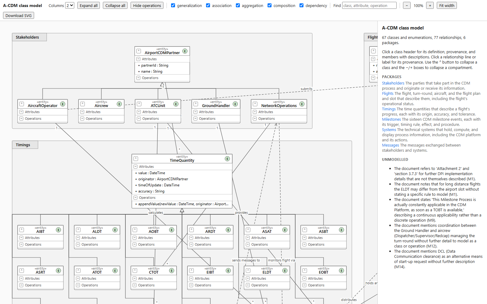

# LLM-generated UML class models of the A-CDM milestone document

### ▶ [Explore a generated class model in your browser](https://darrylteo.github.io/acdm-uml-agents/src/runs/single/run_01/model.html)

[](https://darrylteo.github.io/acdm-uml-agents/src/runs/single/run_01/model.html)

One single-agent run: 67 classes and enumerations, 77 relationships and 6 packages, generated in about 5 minutes. Click any class for its definition and the manual sentence it came from.

This repository holds the code, prompts, generated models, and evaluation materials of a study in which language model agents (`claude-sonnet-5`, called through the Claude Code CLI) derive UML class models from the sixteen milestone tables of the EUROCONTROL Airport CDM Implementation Manual. The models are graded against the document itself, by two researchers (graders A and B) and two language models (`claude-opus-5`, `claude-sonnet-5`), on a 200-item recall sample and a 200-item precision sample.

## Results in brief

Given a minimal scaffold, a single agent returns a class model in about 5 minutes. Graded by the two researchers, the scaffolded models reach a recall of 0.90 to 0.94 and a precision of 0.88 to 0.94. Removing the scaffold lowers recall by 0.16 and 0.23 as graded by the two researchers. Splitting the same instructions across six role-specialised agents costs 3.2 times as much with no significant gain. The two language model graders were more generous than the researchers, most of all on the models that hold the least, so a sample still needs a human grader.

## Layout

```
src/
  data/        document.txt, milestones.json (text of the 16 milestone tables); README.md on the source and the PDFs left out
  ingest/      parse_milestones.py: source PDF -> document.txt, milestones.json
  prompts/     scaffold.md and roles/*.md: every text sent to a model
  schema/      JSON schemas for the model, the per-agent additions, the claim inventory, and the two grading samples
  generate/    client.py (Claude Code CLI wrapper), single_agent.py, multi_agent.py, run.py (resumable runner),
               render.py (JSON -> PlantUML), render_code.py (JSON -> Python class stubs), viewer.py (JSON -> interactive HTML)
  runs/        the scored runs: multi/ (5), single/ (5), single_high/ (5), noscaffold/ (3), control_scaffold_only/ (1, no model call);
               each run holds model.json, its renderings, manifest.json, and every request and raw CLI response
  evaluate/
    inventory.py, claims_draft.json, inventory/      claim inventory: model-drafted, one call per milestone
    claims.json, review_agreement.json, graders/claims_*   frozen inventory and the two reviewers' decisions
    sample.py, sample/{recall,precision}_{items,key}.json  the two 200-item samples (seed 0)
    grade_ui.py, ui/, graders/grade_*.html           the self-contained grading pages
    graders/GRADERS.md                               the instructions the two researchers received
    graders/grades_{recall,precision}_grader_{A,B}.json    the researchers' grades
    judge_sample.py, sample/judge_*_claude-*_high.json     the model graders (grades, cost, per-call metadata), sample/judge_logs/ (requests, raw responses)
    reliability.py, stats.py, paper_numbers.py, structure.py   the analysis (agreement, mean grades, every number in the paper)
    match.py, paths.py, sentences.py, sentences.json   name normalisation, element paths, the frozen sentence split
    selftest.py, lint.py, scaffold_only.py           checks and the deterministic scaffold-only control
results/       output of the reproduction commands below (reliability JSON and logs, numbers.tex, tables/)
```

The two human graders appear as `grader_A` and `grader_B` throughout.

## Setup

Python 3.10 or later. `pip install -r requirements.txt` (`jsonschema` for generation and `scaffold_only.py`; `pdfplumber` only for `src/ingest/parse_milestones.py`). Reproducing the numbers needs the standard library only.

## Reproducing every number

Run from the repository root. The graded data are the files in this repository, so no model call is needed.

```
python src/evaluate/selftest.py     # checks stats.py on hand-computed cases

python src/evaluate/reliability.py recall \
    src/evaluate/graders/grades_recall_grader_A.json src/evaluate/graders/grades_recall_grader_B.json \
    src/evaluate/sample/judge_recall_claude-opus-5_high.json src/evaluate/sample/judge_recall_claude-sonnet-5_high.json

python src/evaluate/reliability.py precision \
    src/evaluate/graders/grades_precision_grader_A.json src/evaluate/graders/grades_precision_grader_B.json \
    src/evaluate/sample/judge_precision_claude-opus-5_high.json src/evaluate/sample/judge_precision_claude-sonnet-5_high.json

python src/evaluate/paper_numbers.py
```

The grade files are passed in this order, and the bootstrap seed is 0, so the intervals are reproducible. `reliability.py` prints each grader's mean grade with a bootstrap interval, the pairwise agreement (Gwet's AC2, with weighted kappa and raw agreement alongside), and the contrasts between configurations, and writes `results/{recall,precision}_reliability.json`. `paper_numbers.py` reads those files, the graded runs' `model.json` and `manifest.json`, and `claims.json`, and writes `results/numbers.tex` (one `\pn{key}` macro per number quoted in the text) and `results/tables/{grades,agreement,structure}.tex`. `results/*.log` are the printed output of the two `reliability.py` calls.

Other checks on the released models:

```
python src/evaluate/lint.py src/runs/*/run_*/model.json src/runs/control_scaffold_only/model.json --md   # structural lint
python src/generate/render_code.py --all                                                                    # regenerates model.py stubs; checks that each compiles, imports and instantiates
python src/evaluate/scaffold_only.py                                                                        # regenerates the deterministic scaffold-only control (needs jsonschema)
python src/generate/viewer.py src/runs/multi/run_01/model.json out.html                                     # interactive diagram of one model
```

The files `src/evaluate/sample/{recall,precision}_items.json` are the exact files the graders saw (the `grade_*.html` pages embed them), and the `*_key.json` files map each item to its run and element or claim; use these for any analysis. `python src/evaluate/sample.py recall` and `... precision` redraw the samples (seed 0, 200 items each, overwriting those files) and select the same items, but a redraw can differ in display details such as a field label. The grading pages are rebuilt with `grade_ui.py`, and the claim inventory with `inventory.py` (see the docstrings).

## Rerunning generation

Generation calls the Claude Code CLI in headless mode, so it needs the `claude` executable on `PATH` and a logged-in Claude subscription session. The exact flags are in `src/generate/client.py`:

```
claude -p --safe-mode --restricted --disable-slash-commands --tools StructuredOutput \
    --system-prompt-file <role prompt> --model claude-sonnet-5 --output-format json \
    --json-schema <inline minified schema> --effort <medium|high>
```

The user message (the scaffold, the document, and, in the multi-agent condition, the artifacts of the earlier agents) is passed on stdin, and each call runs from a neutral working directory. The commands below are those documented in `src/generate/run.py` for the conditions in `src/runs/`:

```
python src/generate/run.py --condition single     --n 5
python src/generate/run.py --condition multi      --n 5 --pace 120
python src/generate/run.py --condition single     --n 5 --effort high --out single_high
python src/generate/run.py --condition noscaffold --n 3
python src/evaluate/scaffold_only.py
```

`run.py` skips a run directory that already holds `model.json`, so to generate fresh runs pass a new `--out` name or remove the directory. Model output is not deterministic, so a rerun will not reproduce the released models. The model graders are rerun with `python src/evaluate/judge_sample.py <recall|precision> --model <claude-opus-5|claude-sonnet-5> --effort high`; the recall grades of `claude-sonnet-5` were produced with `--role judge_recall_sonnet.md`, and every other grading call used the task's default prompt in `src/prompts/roles/`.

## Not included

The PDFs of the manual (see `src/data/README.md`) and the development runs made while building the pipeline, which are not part of the scored set.

## Citation

Darryl Teo, Adharsha Sam, Rakesh Nagi, and Nuno Antunes Ribeiro. Manual Labour: Scaffolded Language Model Agents Turn the Airport CDM Manual into a Class Model. Submitted to the Aviation Innovation Conference for Asia-Pacific (AICAP 2027).

## Licence

Code is MIT and data is CC BY 4.0; the extracted manual text remains EUROCONTROL's. See `LICENSE` for the exact split.
